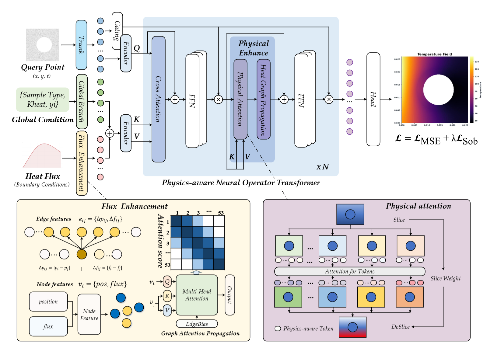
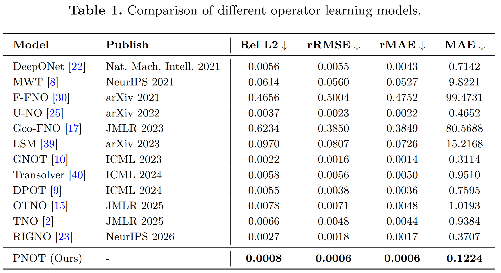

## PNOT: Physics-aware Neural Operator Transformer for Temperature Field Reconstruction

You can find the paper here: [Temperature Field Reconstruction of Tungsten Monoblock Divertor on EAST using Physics-aware Neural Operator Transformer](https://arxiv.org/abs/2606.31574)

Zikang Yan, Xiao Wang, Qingquan Yang, Zhendong Yang *, Gaoting Chen, Zehua Chen, Bo Jiang, Jin Tang, and Guosheng Xu. arXiv:2606.31574.



Table 1 compares PNOT with other operator learning models for temperature field reconstruction. PNOT achieves the lowest errors across all four metrics: relative L2, rRMSE, rMAE, and MAE.



### Usage

##### Data Availability

The dataset may be made available upon reasonable request, subject to applicable conditions. Please contact the authors to request access.

##### Single GPU Training

Run the following commands from the PNOT directory after updating the dataset paths:

```bash
cd src
python HeatOperator/run_train.py --config config.yaml
```

##### Configuration file

`src/config.yaml` defines the dataset paths, data split, model architecture, training parameters, loss weights, and evaluation settings. For example, replace the dataset paths below with your local absolute paths:

```yaml
paths:
  dataset: /path/to/heat_operator_dataset.npy
  positions: /path/to/qheat_pos.npy
  output_root: result

training:
  epochs: 300
  batch_size: 4
  lr: 0.001

loss:
  sobolev_weight: 0.01
  sobolev_k: 4

evaluation:
  eval_time_indices: [500]
```

Command-line overrides use `--override key=value` and can be repeated. Adjust `evaluation.eval_time_indices` and `data.viz_time_indices` to valid indices for your dataset.

Training saves checkpoints, epoch metrics, a metrics summary, logs, the resolved configuration, prediction figures, and a Markdown report under the configured output root. The included `src/result/` directory contains saved checkpoints, metrics, logs, and figures from an existing run.

##### Requirement

Use Python 3.10 or later and install the packages imported by the implementation:

```bash
pip install torch numpy matplotlib PyYAML
```

For GPU training, use a CUDA-enabled PyTorch installation compatible with your environment. Package versions are not pinned in the current project.

### Code Structure

- `src/config.yaml`: dataset, model, training, loss, and evaluation configuration.
- `src/run.sh`: Bash launcher with device and run-name overrides.
- `src/HeatOperator/run_train.py`: training entry point.
- `src/HeatOperator/pnot_heat/model.py`: PNOT architecture, including physics attention and graph modules.
- `src/HeatOperator/pnot_heat/data.py`: dataset loading, feature construction, splitting, normalization, and data loaders.
- `src/HeatOperator/pnot_heat/train.py`: training, evaluation, checkpointing, and visualization.
- `src/HeatOperator/pnot_heat/utils.py`: configuration loading, overrides, logging, metrics, and utility functions.
- `src/result/`: saved checkpoints, metrics, logs, configuration, and reconstruction figures.


